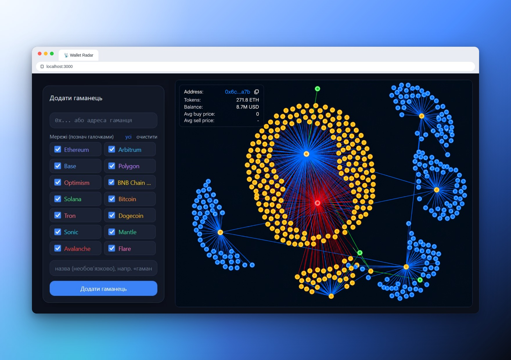
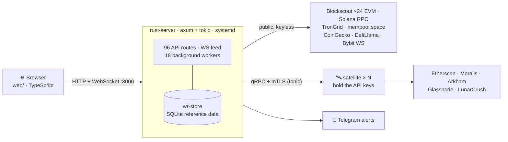
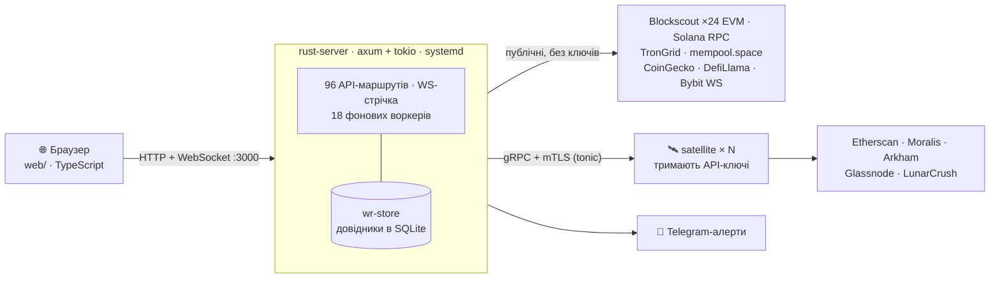

<a name="en"></a>

<div align="center">

# 📡 Wallet Radar

<a href="#en"></a>&nbsp;<a href="#ua"></a>

### What smart money is doing — in one screen.

A multi-chain on-chain intelligence terminal for retail traders: whale accumulation,
coordinated capital groups, pump phases and liquidations, all on one screen.




<sub>Pick any of 14 networks for a wallet (left) and explore its on-chain connection graph (right). The UI is shown in Ukrainian; 5 languages are available.</sub>

</div>

---

<div align="center">

<table>
  <tr>
    <td align="center" width="140"><a href="#en-about">📦<br><b>About</b></a></td>
    <td align="center" width="140"><a href="#en-what">🎯<br><b>What it does</b></a></td>
    <td align="center" width="140"><a href="#en-arch">🏗<br><b>Architecture</b></a></td>
    <td align="center" width="140"><a href="#en-langs">🧬<br><b>Languages</b></a></td>
    <td align="center" width="140"><a href="#en-migration">🦀<br><b>Rust migration</b></a></td>
    <td align="center" width="140"><a href="#en-run">🚀<br><b>Running</b></a></td>
  </tr>
  <tr>
    <td align="center" width="140"><a href="#en-config">⚙️<br><b>Configuration</b></a></td>
    <td align="center" width="140"><a href="#en-api">🔌<br><b>API</b></a></td>
    <td align="center" width="140"><a href="#en-structure">🗂<br><b>Structure</b></a></td>
    <td align="center" width="140"><a href="#en-tests">🧪<br><b>Testing</b></a></td>
    <td align="center" width="140"><a href="#en-license">📄<br><b>License</b></a></td>
    <td align="center" width="140"><a href="#ua">🌐<br><b>Українська</b></a></td>
  </tr>
</table>

</div>

<a name="en-about"></a>
## 📦 About this repository

This is the **engine without the data**: the analysis code, not its results. Deliberately **not** included:

- `dataset/` — collected research data (tens of thousands of addresses);
- `server/` — the legacy Node backend being phased out (Rust is the source of truth);
- golden test fixtures (`rust-server/tests/fixtures/`) — they are snapshots of real data;
- internal reports, session notes and the infrastructure runbook.

Reference data (exchange addresses, thresholds, groups, strategy parameters) lives in **SQLite**
(the `wr-store` crate), not in the code — see `wr-store/migrations/`. Without the database the
application **refuses to start and explains what to do** instead of running on zeros; a database
that lacks required tags starts, but logs exactly what is missing. Populate it with `wr-import load`
from the authors' seed files (`wr-import extract` needs the full repository history, which the
public version does not have).

> [!NOTE]
> The public version also lacks `rust-server/src/groupgraph.rs` and part of the `nextaction`
> binaries (29 of the 73 listed in `Cargo.toml`), so these crates do not build without them.

<a name="en-what"></a>
## 🎯 What it does

Tracks wallets across many networks:

- **balances and portfolio** with a chart, a **live event feed**;
- **connection graph** (the "web"), **Tracer** (fund-flow tracing), **Alerts** (notification rules);
- **entity profiles**, a configurable **Dashboard**;
- **search** across assets and addresses on every network;
- a **5-language** interface.

The key feature is **detection of "desks" and capital groups**: finding coordinated whales,
merging sub-networks, classifying archetypes, monthly activity, and an intelligence page with a
live force graph (`/network.html`).

<a name="en-arch"></a>
## 🏗 Architecture

**Production is Rust.** The backend, the backfill and all background analytics run in Rust.
The legacy Node server is kept in the authors' working tree **only as a parity oracle** for
`parity_check`; it does not run in production and is not part of the public repository.
Details: [Languages](#en-langs).



**Security model (deliberate): the core holds no keys.** Every call to a paid or keyed API goes
over gRPC + mTLS to a satellite, which injects the key from its own environment. `Fetch` in
`proto/satellite.proto` is intentionally generic — the satellite returns the provider's body
**byte for byte**, so the golden-tested parsers of the core stay untouched. Providers come only
from an allowlist; an arbitrary host cannot be passed (SSRF protection).

<a name="en-langs"></a>
## 🧬 Languages

What is written in what, and what **actually runs in production**:

| Component | Language | Prod? | Role |
|---|---|---|---|
| `rust-server/` | **Rust** | ✅ yes | Backend :3000 — 96 API routes, WS, 18 background workers. The main process. |
| `backfill/` | **Rust** | ✅ yes | Backfill into Elasticsearch (`backfill2`) + binaries `relay-monitor`, `supply`, `eth-*`, `btc-*`, `distrib-alert`… |
| `nextaction/` | **Rust** | ✅ yes | Analytics binaries (73 in `Cargo.toml`): `strategy`, `volatility`, `sector`, `rotation`, `pnl`, `cohort`, `capgroups`, `rg*`, `train`, `merge-graph`… |
| `features/` | **Rust** | ✅ yes | Feature extraction, family clustering, `model`. |
| `satellite/` | **Rust** | ✅ yes | Key-holding proxy (gRPC/mTLS). |
| `gat/` | **Rust** | ⏸ offline | Graph Attention Network (ML), separate Dockerfile. |
| `web/` (`src/*.ts`) | **TypeScript** | ✅ yes | Frontend. Compiled to the browser `app.js` (esbuild) — **cannot be Rust by definition**. |
| `deploy/*.sh`, `diskguard.sh` | **Shell** | ✅ yes | Cron glue: schedules and runs the Rust binaries. |
| `deploy/group-monitor.py` | **Python** | ⚠️ **yes** | **The only functional non-Rust code in production.** Daily Telegram digest for 2 groups. A porting candidate (see below). |
| `server/*.js`, `*.mjs` | **Node** | ❌ **no** | Legacy implementation, **not run**. Oracle for `parity_check`. Not in the public repository. |
| `scripts/`, `tools/gen_*` | **Node** | 🔧 build | Helpers: `stamp-assets.mjs`, golden-fixture generators. |
| `test/*.test.ts` | **TypeScript** | 🧪 CI | Tests via `node --test`. Not in the public repository. |

<a name="en-migration"></a>
## 🦀 Rust migration status

The port from Node to Rust is **effectively complete**:

- **Rust serves 96 API routes — a superset of the 70 legacy Node routes.** No functionality was lost; Rust has more.
- **`parity_check`** (a binary in `rust-server/src/bin/`) compares key routes **byte for byte** between Node and Rust. It is a safeguard: while it is green, Rust is guaranteed not to have drifted from the verified behaviour of earlier iterations. That is why `server/` is kept alive as a reference.
- Even the Python version of the parity checker has been ported to Rust (`tools/parity_check.py` removed).

**What is still not Rust, and why:**

1. **`deploy/group-monitor.py`** — the only non-Rust runtime. It crawls ETH ERC-20 incrementally for the cores of 2 groups and sends a Telegram delta. The port is realistic: Rust already has overlapping binaries (`netflow`, `emission`, `distrib-alert`) and `telegram.rs`. ⚠️ An extra motive: the script reads `.env` **directly**, i.e. it bypasses the "keyless core" model. A Rust binary going through a satellite would close that too.
2. **Frontend (`web/src`)** — browser code, not portable to Rust (except via WASM, which is not worth it).
3. **Shell glue** — fine as a scheduler; rewriting it in Rust makes little sense.
4. **Node `server/` + `.mjs`** — intentionally kept as the parity oracle. Deleting it would remove the safeguard against regressions, so it is **not touched**.

<a name="en-run"></a>
## 🚀 Running

### Production (how it runs on the server)

The backend is a systemd service, not Docker and not `npm start`:

```bash
# build the release
cd rust-server && cargo build --release

# manage the service (unit: deploy/wallet-radar-rust.service)
systemctl status  wallet-radar-rust.service      # main backend :3000
systemctl restart wallet-radar-rust.service
journalctl -u wallet-radar-rust.service -f       # logs

# background Rust jobs — systemd timers and crontab (deploy/*.sh)
systemctl list-timers 'wallet-*'
crontab -l
```

### Frontend

Sources: `web/src/*.ts` + `web/tw-input.css`. Build before serving:

```bash
npm install
npm run build     # typecheck (tsc) + esbuild (web/src/main.ts → web/app.js) + tailwind + stamp-assets
```

The Rust server serves the `web/` static files and the API from the same port `:3000`.

### Local Docker (legacy, for reference)

`docker-compose.yml` builds the **old Node version** — this is not production. Its `Dockerfile`
copies `server/` and `dataset/`, which are **not in the public repository**, so it does not build
here. For production behaviour use Rust + satellites.

<a name="en-config"></a>
## ⚙️ Configuration and secrets

- **`.env`** (mode `600`, in `.gitignore`) — only the core's own secrets: passwords, `TELEGRAM_BOT_TOKEN`, `SENTRY_DSN`, `ADMIN_PASSWORD` / `APP_PASSWORD`.
- **The core's `.env` has NO keys for Etherscan / Moralis / Arkham / Glassnode / LunarCrush** — the satellites hold them (`deploy/docker-compose.satellites.yml` + `deploy/.env`, see [`docs/satellites.md`](docs/satellites.md)).
- **mTLS PKI** for the satellites — `deploy/pki/out/` (in `.gitignore`).
- Background workers are switched on one by one with `ENABLE_*_WORKER=1` (all are off by default); the reference database path is set by `WR_DB`.

<a name="en-api"></a>
## 🔌 API

- The server exposes **96 API routes** plus WebSocket `/ws`.
- Specification: `rust-server/src/openapi_spec.json` — describes **19 key routes** (not all 96).
- Core endpoints: `GET /api/config`, `/api/wallets` (+`POST`/`DELETE`), `/api/events?limit=N`, `/api/whale-assets`, `/api/capital-groups`, `/api/cross-asset`, `/api/asset-forensics`, `/api/meta-subnets`, WS `ws://…/ws`.
- Sign-in: the `/login.html` form (session cookie for 12 hours) or HTTP Basic. Passwords: `ADMIN_PASSWORD` (admin) / `APP_PASSWORD` (read-only viewer). With no passwords set, local mode lets everyone in.

<a name="en-structure"></a>
## 🗂 Structure

```
rust-server/       PRODUCTION. axum backend, 85 modules + bin/parity_check
  src/openapi_spec.json    API specification (19 key routes)
wr-store/          SQLite reference data + migrations + wr-import tool
wr-dict/           Shared dictionaries on top of wr-store
backfill/          Rust: backfill into Elasticsearch + binaries (relay-monitor, supply, eth-*, btc-*)
nextaction/        Rust: analytics binaries (strategy, volatility, capgroups, rg*, train, cohort…)
features/          Rust: feature extraction, family clustering, model
patterns/          Rust: pattern engine for finding coordinated capital groups (+ orderbook, tradetape)
satellite/         Rust: key-holding proxy (gRPC/mTLS)
gat/               Rust: Graph Attention Network (offline ML)
proto/             satellite.proto — core ↔ satellite contract
web/               Frontend: src/*.ts → app.js (esbuild) + app.css (tailwind); index.html, network.html
deploy/            Cron scripts (shell) + group-monitor.py + PKI + satellites compose
docs/              satellites.md, brandbook.html
scripts/, tools/   Build helpers (Node): fixture generators, stamp-assets

Not in the public repository:
dataset/           Live datasets/models (JSON/CSV)
server/            LEGACY Node — not run; oracle for parity_check
test/              node --test (*.test.ts)
old/               Archive of removed dev artefacts
.env               Core secrets (600, never committed)
```

<a name="en-tests"></a>
## 🧪 Testing

```bash
npm test                                    # node --test: golden parity of parsers
cd rust-server && cargo test                # Rust unit tests
# Node↔Rust parity: Node on 3000, Rust on 3001
cargo run --release --bin parity_check
```

Golden fixtures are generated by `tools/gen_*_fixtures.mjs`; they pin the reference output of the
parsers that both implementations are checked against.

> [!NOTE]
> The golden fixtures and `test/` are not in the public repository, so `npm test` and
> `cargo test` in `rust-server` do not run without them. `cargo test` in `wr-store` works.

<a name="en-license"></a>
## 📄 License

Proprietary. © 2026 Vitalii Vedana. All rights reserved. See [`LICENSE`](LICENSE).

<div align="right"><a href="#en">↑ Top</a> · <a href="#ua">Українська ↓</a></div>

---
---

<a name="ua"></a>

<div align="center">

# 📡 Wallet Radar

<a href="#en"></a>&nbsp;<a href="#ua"></a>

### Що робить розумний капітал — на одному екрані.

Мультичейн-термінал ончейн-розвідки для роздрібного трейдера: накопичення китів,
координовані групи капіталу, фази пампу й ліквідації — на одному екрані.

</div>

<div align="center">

<table>
  <tr>
    <td align="center" width="140"><a href="#ua-about">📦<br><b>Про репозиторій</b></a></td>
    <td align="center" width="140"><a href="#ua-what">🎯<br><b>Що це робить</b></a></td>
    <td align="center" width="140"><a href="#ua-arch">🏗<br><b>Архітектура</b></a></td>
    <td align="center" width="140"><a href="#ua-langs">🧬<br><b>Мовний склад</b></a></td>
    <td align="center" width="140"><a href="#ua-migration">🦀<br><b>Міграція на Rust</b></a></td>
    <td align="center" width="140"><a href="#ua-run">🚀<br><b>Запуск</b></a></td>
  </tr>
  <tr>
    <td align="center" width="140"><a href="#ua-config">⚙️<br><b>Конфігурація</b></a></td>
    <td align="center" width="140"><a href="#ua-api">🔌<br><b>API</b></a></td>
    <td align="center" width="140"><a href="#ua-structure">🗂<br><b>Структура</b></a></td>
    <td align="center" width="140"><a href="#ua-tests">🧪<br><b>Тестування</b></a></td>
    <td align="center" width="140"><a href="#ua-license">📄<br><b>Ліцензія</b></a></td>
    <td align="center" width="140"><a href="#en">🌐<br><b>English</b></a></td>
  </tr>
</table>

</div>

<a name="ua-about"></a>
## 📦 Про цей репозиторій

Тут лежить **рушій без даних**: код аналізу, але не результати. Свідомо **не** включено:

- `dataset/` — зібрані дані досліджень (десятки тисяч адрес);
- `server/` — легасі Node-бекенд, який витісняється (джерело правди — Rust);
- golden-фікстури тестів (`rust-server/tests/fixtures/`) — це знімки реальних даних;
- внутрішні звіти, нотатки сесій і runbook інфраструктури.

Довідники (адреси бірж, пороги, групи, параметри стратегій) живуть у **SQLite** (крейт
`wr-store`), а не в коді — див. `wr-store/migrations/`. Без бази застосунок **не стартує й
пояснює, що робити**, а не працює на нулях; база без потрібних тегів стартує, але пише в лог,
чого саме бракує. Наповнити: `wr-import load` із seed-файлів авторів (`wr-import extract`
потребує повної історії репозиторію, якої в публічній версії немає).

> [!NOTE]
> У публічній версії також бракує `rust-server/src/groupgraph.rs` і частини бінів `nextaction`
> (29 із 73, перелічених у `Cargo.toml`), тому без них ці крейти не збираються.

<a name="ua-what"></a>
## 🎯 Що це робить

Відстежує гаманці в багатьох мережах:

- **баланси й портфель** із графіком, **жива стрічка подій**;
- **граф зв'язків** («павутина»), **Tracer** (трасування потоків), **Alerts** (правила сповіщень);
- **Entity-профілі**, настроюваний **Dashboard**;
- **пошук** по активах і адресах усіх мереж;
- інтерфейс **5 мовами**.

Ключова риса — **детекція «десків» і капітал-груп**: пошук координованих китів, злиття
під-мереж, класифікація архетипів, помісячна активність, розвідсторінка з живим force-графом
(`/network.html`).

<a name="ua-arch"></a>
## 🏗 Архітектура

**Прод — це Rust.** Бекенд, бекфіл і всі фонові аналітичні задачі виконує Rust. Легасі
Node-сервер лишається в робочому дереві авторів **лише як еталон парності** для `parity_check`,
у проді не запускається й до публічного репозиторію не входить. Деталі — у розділі
[Мовний склад](#ua-langs).



**Модель безпеки (свідома): кор не тримає ключів.** Кожен виклик платного/keyed API йде по
gRPC поверх mTLS до сателіта, який підставляє ключ уже зі свого оточення. `Fetch` у
`proto/satellite.proto` навмисно загальний — сателіт повертає тіло провайдера **байт-у-байт**,
тож golden-перевірені парсери кора лишаються недоторканими. Провайдер лише з allowlist —
довільний хост передати неможливо (захист від SSRF).

<a name="ua-langs"></a>
## 🧬 Мовний склад

Що на чому написано і що з цього **реально виконується в проді**:

| Компонент | Мова | Прод? | Роль |
|---|---|---|---|
| `rust-server/` | **Rust** | ✅ так | Бекенд :3000 — 96 API-маршрутів, WS, 18 фонових воркерів. Головний процес. |
| `backfill/` | **Rust** | ✅ так | Бекфіл в Elasticsearch (`backfill2`) + біни `relay-monitor`, `supply`, `eth-*`, `btc-*`, `distrib-alert`… |
| `nextaction/` | **Rust** | ✅ так | Біни аналітики (73 у `Cargo.toml`): `strategy`, `volatility`, `sector`, `rotation`, `pnl`, `cohort`, `capgroups`, `rg*`, `train`, `merge-graph`… |
| `features/` | **Rust** | ✅ так | Витяг ознак, кластеризація родин, `model`. |
| `satellite/` | **Rust** | ✅ так | Key-holding проксі (gRPC/mTLS). |
| `gat/` | **Rust** | ⏸ офлайн | Graph Attention Network (ML), окремий Dockerfile. |
| `web/` (`src/*.ts`) | **TypeScript** | ✅ так | Фронтенд. Компілюється в браузерний `app.js` (esbuild) — **на Rust бути не може за визначенням**. |
| `deploy/*.sh`, `diskguard.sh` | **Shell** | ✅ так | Клей крону: планують і запускають Rust-біни. |
| `deploy/group-monitor.py` | **Python** | ⚠️ **так** | **Єдиний функціональний не-Rust у проді.** Щоденний Telegram-дайджест по 2 групах. Кандидат на порт (див. нижче). |
| `server/*.js`, `*.mjs` | **Node** | ❌ **ні** | Легасі-реалізація, **не запускається**. Еталон для `parity_check`. До публічного репозиторію не входить. |
| `scripts/`, `tools/gen_*` | **Node** | 🔧 build | Допоміжні: `stamp-assets.mjs`, генератори golden-фікстур. |
| `test/*.test.ts` | **TypeScript** | 🧪 CI | Тести через `node --test`. До публічного репозиторію не входять. |

<a name="ua-migration"></a>
## 🦀 Статус міграції на Rust

Порт із Node на Rust **фактично завершено**:

- **Rust віддає 96 API-маршрутів — надмножина 70 маршрутів легасі-Node.** Функціонал не втрачено, у Rust його більше.
- **`parity_check`** (бін у `rust-server/src/bin/`) звіряє ключові маршрути **байт-у-байт** між Node і Rust. Це запобіжник: поки він зелений, Rust гарантовано не розійшовся з перевіреною поведінкою попередніх ітерацій. Тому `server/` тримають живим — як референс.
- Навіть Python-версію парність-чекера вже портовано в Rust (`tools/parity_check.py` прибрано).

**Що ще НЕ на Rust і чому:**

1. **`deploy/group-monitor.py`** — єдиний не-Rust runtime. Робить інкрементальний краул ETH ERC-20 по ядрах 2 груп і шле Telegram-дельту. Порт реальний: у Rust уже є перекривні біни (`netflow`, `emission`, `distrib-alert`) і `telegram.rs`. ⚠️ Додатковий мотив: скрипт читає `.env` **напряму** — тобто обходить модель «кор без ключів». Порт у Rust-бін, що ходить через сателіт, закрив би і це.
2. **Фронтенд (`web/src`)** — браузерний код, на Rust не переноситься (хіба WASM, що недоцільно).
3. **Shell-клей** — доречний як планувальник; переписувати в Rust сенсу мало.
4. **Node `server/` + `.mjs`** — навмисно лишаються як еталон парності. Видалення = втрата запобіжника проти регресій, тому НЕ чіпаємо.

<a name="ua-run"></a>
## 🚀 Запуск

### Прод (як воно працює на сервері)

Бекенд — systemd, не Docker і не `npm start`:

```bash
# зібрати реліз
cd rust-server && cargo build --release

# керування сервісом (юніт: deploy/wallet-radar-rust.service)
systemctl status  wallet-radar-rust.service      # головний бекенд :3000
systemctl restart wallet-radar-rust.service
journalctl -u wallet-radar-rust.service -f       # логи

# фонові Rust-задачі — по systemd-таймерах і crontab (deploy/*.sh)
systemctl list-timers 'wallet-*'
crontab -l
```

### Фронтенд

Джерело — `web/src/*.ts` + `web/tw-input.css`. Перед подачею зібрати:

```bash
npm install
npm run build     # typecheck (tsc) + esbuild (web/src/main.ts → web/app.js) + tailwind + stamp-assets
```

Rust-сервер віддає статику `web/` та API з одного порту `:3000`.

### Локальний Docker (легасі, довідково)

`docker-compose.yml` збирає **стару Node-збірку** — це не прод. Її `Dockerfile` копіює `server/`
і `dataset/`, яких **немає в публічному репозиторії**, тож тут вона не збирається. Для
відтворення прод-поведінки використовуйте Rust + сателіти.

<a name="ua-config"></a>
## ⚙️ Конфігурація та секрети

- **`.env`** (права `600`, у `.gitignore`) — лише власні секрети кора: паролі, `TELEGRAM_BOT_TOKEN`, `SENTRY_DSN`, `ADMIN_PASSWORD` / `APP_PASSWORD`.
- **Ключів до Etherscan / Moralis / Arkham / Glassnode / LunarCrush у `.env` кора НЕМАЄ** — їх тримають сателіти (`deploy/docker-compose.satellites.yml` + `deploy/.env`, див. [`docs/satellites.md`](docs/satellites.md)).
- **mTLS-PKI** сателітів — `deploy/pki/out/` (у `.gitignore`).
- Фонові воркери вмикаються поодинці через `ENABLE_*_WORKER=1` (за замовчуванням усі вимкнені); шлях до бази довідників задає `WR_DB`.

<a name="ua-api"></a>
## 🔌 API

- Сервер віддає **96 API-маршрутів** плюс WebSocket `/ws`.
- Специфікація: `rust-server/src/openapi_spec.json` — описує **19 ключових маршрутів** (не всі 96).
- Базові: `GET /api/config`, `/api/wallets` (+`POST`/`DELETE`), `/api/events?limit=N`, `/api/whale-assets`, `/api/capital-groups`, `/api/cross-asset`, `/api/asset-forensics`, `/api/meta-subnets`, WS `ws://…/ws`.
- Вхід: форма `/login.html` (сесійна cookie на 12 годин) або HTTP Basic. Паролі: `ADMIN_PASSWORD` (адмін) / `APP_PASSWORD` (глядач, лише читання). Без паролів — локальний режим, пускає всіх.

<a name="ua-structure"></a>
## 🗂 Структура

```
rust-server/       ПРОД. axum-бекенд, 85 модулів + bin/parity_check
  src/openapi_spec.json    специфікація API (19 ключових маршрутів)
wr-store/          Довідники в SQLite + міграції + утиліта wr-import
wr-dict/           Спільні словники поверх wr-store
backfill/          Rust: бекфіл в Elasticsearch + біни (relay-monitor, supply, eth-*, btc-*)
nextaction/        Rust: біни аналітики (strategy, volatility, capgroups, rg*, train, cohort…)
features/          Rust: витяг ознак, кластеризація родин, model
patterns/          Rust: рушій патернів пошуку координованих груп капіталу (+ orderbook, tradetape)
satellite/         Rust: key-holding проксі (gRPC/mTLS)
gat/               Rust: Graph Attention Network (офлайн-ML)
proto/             satellite.proto — контракт кор↔сателіт
web/               Фронтенд: src/*.ts → app.js (esbuild) + app.css (tailwind); index.html, network.html
deploy/            Крон-скрипти (shell) + group-monitor.py + PKI + satellites-compose
docs/              satellites.md, brandbook.html
scripts/, tools/   Build-хелпери (Node): генератори фікстур, stamp-assets

Не входить у публічний репозиторій:
dataset/           Живі датасети/моделі (JSON/CSV)
server/            ЛЕГАСІ Node — НЕ запускається; еталон для parity_check
test/              node --test (*.test.ts)
old/               Архів прибраних dev-артефактів
.env               Секрети кора (600, не комітиться)
```

<a name="ua-tests"></a>
## 🧪 Тестування

```bash
npm test                                    # node --test: golden-парність парсерів
cd rust-server && cargo test                # Rust-юніти
# парність Node↔Rust: Node на 3000, Rust на 3001
cargo run --release --bin parity_check
```

Golden-фікстури генерують `tools/gen_*_fixtures.mjs`; вони фіксують еталонний вихід парсерів,
проти якого звіряються обидві реалізації.

> [!NOTE]
> Golden-фікстур і `test/` у публічному репозиторії немає, тож `npm test` і `cargo test` у
> `rust-server` без них не запускаються. `cargo test` у `wr-store` працює.

<a name="ua-license"></a>
## 📄 Ліцензія

Пропрієтарна. © 2026 Vitalii Vedana. Усі права захищено. Див. [`LICENSE`](LICENSE).

<div align="right"><a href="#en">↑ English</a> · <a href="#ua">↑ Українська</a></div>
