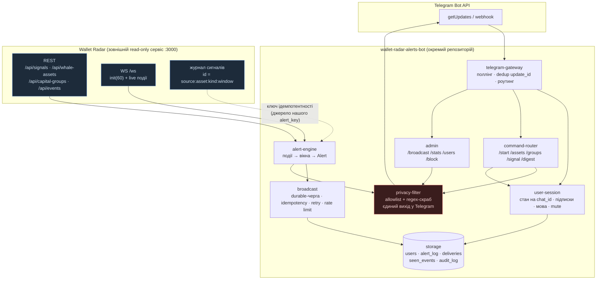

# Wallet Radar Alerts Bot — дизайн (A–F)

Статус: дизайн затверджується до коду. Реалізація — ітеративно, після цього документу.

---

## A) Огляд архітектури



**Потоки даних:**

| Потік | Джерело → | Природа | Гарантія |
|---|---|---|---|
| Алерт | `alert-engine` → `broadcast` → усім підключеним | fan-out | `alert_key` UNIQUE + `deliveries(chat_id, alert_key)` PK → «рівно один» на користувача |
| Відповідь | `command-router` → `privacy-filter` → chat джерела | точка-точка | тільки в `chat_id` джерела, тільки приватний чат |
| Стан | `wr-client` → `Snapshot` | read-only, раз на 60 с | кеш у БД (`snapshots`), переживає рестарт |
| Доказ | `RawEvent` → `Alert` | нормалізація вікна | `evidence_digest` у `alert_key` |

**Три заповіді конструкції:**

1. **Джерело не довіряємо** — сирий JSON не перетинає межу `wr-client`; назовні йдуть лише типи без адрес.
2. **Вихід — через один фільтр** — `privacy-filter` стоїть перед *кожним* повідомленням у Telegram, включно з ручними `/broadcast`.
3. **Джерело може зникнути** — бот лишається живим і позначає віком даних, а не мовчить.

---

## B) Модулі та ключові Rust-сигнатури

### B.1 `privacy-filter` — санітизація

```rust
pub enum RedactionKind { EvmAddress, TxHash, Base58Address, EnsName, ExplorerUrl, LongHex }

pub struct Redaction { pub kind: RedactionKind, pub at: usize, pub len: usize }

pub struct ScrubReport {
    pub text: String,              // готовий до відправки текст
    pub redactions: Vec<Redaction>,// вид і позиція — БЕЗ самого значення
}

pub trait Sanitizer {
    fn scrub(&self, text: &str) -> ScrubReport;
    fn scrub_outbound(&self, msg: &Outbound) -> ScrubReport; // + перевірка довжини 4096
}

pub struct PrivacyFilter { mask: String, rules: Vec<Box<dyn Rule>> /* тут dyn виправдано: набір правил підминяється в тестах */ }
```

Правила (вимкнені за замовчуванням — див. `[privacy]`):

| Rule | Патерн | Заміна |
|---|---|---|
| `EvmAddress` | `0x` + 40 hex | `приховано` |
| `TxHash` | `0x` + 64 hex | `приховано` |
| `Base58Address` | base58, рівно 32..=44 символ. | `приховано` |
| `EnsName` | `name.eth` | `приховано` |
| `ExplorerUrl` | etherscan/solscan/blockscout/dexscreener/… | `приховано` |
| `LongHex` | hex ≥ 32 символ. (запобіжник) | `приховано` |

Нормалізація перед скрейбом: NFKC, зрізання zero-width (`U+200B..U+200F`, `U+FEFF`).

### B.2 `storage` — сховище

```rust
pub struct NewUser { pub chat_id: i64, pub user_id: Option<i64>, pub username: Option<String> }
pub struct User { pub chat_id: i64, pub user_id: Option<i64>, pub role: Role,
                  pub language: Language, pub timezone: Tz, pub timeframe: Timeframe,
                  pub muted: bool, pub blocked: bool, pub state: UserState,
                  pub created_at: i64, pub updated_at: i64 }
pub struct Settings { pub language: Language, pub timezone: Tz, pub timeframe: Timeframe, pub muted: bool }
pub struct Subscription { pub chat_id: i64, pub topic: Topic, pub min_severity: Severity }
pub struct NewDelivery { pub chat_id: i64, pub alert_key: String, pub priority: Priority }
pub struct Delivery { pub chat_id: i64, pub alert_key: String, pub priority: Priority,
                      pub status: DeliveryStatus, pub attempts: u32, pub next_attempt_at: i64 }
pub struct AuditEntry { pub chat_ref: String, pub actor: Actor, pub action: String, pub detail: Option<String>, pub at: i64 }
pub struct Purged { pub users: u32, pub deliveries: u32, pub audits: u32 }

pub trait Store {
    fn upsert_user(&self, u: NewUser) -> impl Future<Output = Result<User>>;
    fn get_user(&self, chat_id: i64) -> impl Future<Output = Result<Option<User>>>;
    fn find_user_by_user_id(&self, user_id: i64) -> impl Future<Output = Result<Option<User>>>;
    fn set_settings(&self, chat_id: i64, s: &Settings) -> impl Future<Output = Result<()>>;
    fn subscriptions(&self, chat_id: i64) -> impl Future<Output = Result<Vec<Subscription>>>;
    fn set_subscription(&self, s: &Subscription) -> impl Future<Output = Result<()>>;
    fn user_assets(&self, chat_id: i64) -> impl Future<Output = Result<Vec<String>>>;
    fn set_user_asset(&self, chat_id: i64, symbol: &str, on: bool) -> impl Future<Output = Result<()>>;

    /// Ідемпотентно: Ok(false) — такий alert_key вже є.
    fn register_alert(&self, a: &Alert) -> impl Future<Output = Result<bool>>;
    fn enqueue_delivery(&self, d: NewDelivery) -> impl Future<Output = Result<()>>;
    fn due_deliveries(&self, now: i64, limit: u32) -> impl Future<Output = Result<Vec<Delivery>>>;
    fn claim_deliveries(&self, now: i64, limit: u32) -> impl Future<Output = Result<Vec<Delivery>>>;
    fn finish_delivery(&self, d: DeliveryUpdate) -> impl Future<Output = Result<()>>;
    fn recipients(&self, a: &Alert) -> impl Future<Output = Result<Vec<i64>>>;

    fn seen_event(&self, event_id: &str, ts: i64) -> impl Future<Output = Result<bool>>;
    fn seen_update(&self, update_id: i64) -> impl Future<Output = Result<bool>>;
    fn cursor(&self, name: &str) -> impl Future<Output = Result<Option<String>>>;
    fn set_cursor(&self, name: &str, v: &str) -> impl Future<Output = Result<()>>;

    fn put_snapshot(&self, s: &Snapshot) -> impl Future<Output = Result<()>>;
    fn last_snapshot(&self) -> impl Future<Output = Result<Option<Snapshot>>>;

    fn audit(&self, a: AuditEntry) -> impl Future<Output = Result<()>>;
    fn purge_user(&self, user_id: i64) -> impl Future<Output = Result<Purged>>;
}
```

Реалізації: `SqliteStore` (SQLite, `rusqlite`, WAL), `PostgresStore`
(PostgreSQL, `sqlx`, `FOR UPDATE SKIP LOCKED`). Трейт узагальнений, не `dyn` —
мономорфізація, два бекенди без динаміки.

Бекенд обирається **під час старту** (конфіг `[storage] backend`), а не на
етапі компіляції: один бінарник може працювати і з SQLite, і з Postgres, а
відкат не вимагає перебірки. Код при цьому один — трейт узагальнений за `S`,
тому компілятор породжує окрему мономорфізацію для кожного бекенда (без
`dyn`-диспетчеризації).

Усі асинхронні методи трейта повертають `Send`-футури: виклики сховища
робляться всередині `tokio::spawn`, і без цієї гарантії дженеричний код
не компілювався б.

### B.3 `wr-client` — зовнішній сервіс

```rust
pub enum Network { Eth, Bsc, Base, Arbitrum, Solana, Tron, Other(String) }
pub enum FlowKind { In, Out, Self_ }

/// Сире. Живе ТІЛЬКИ в цьому крейті.
pub struct RawEvent { pub id: String, pub wallet_id: String, pub network: Network,
                      pub flow: FlowKind, pub asset_symbol: String, pub chain: String,
                      pub amount: f64, pub value_usd: f64, pub ts: i64, pub tx_hash: Option<String> }

/// Публічне. Адреси тут немає в принципі.
pub struct AssetLabel { pub symbol: String, pub name: String, pub chain: String }
pub struct FamilySignal { pub family_id: String, pub size: u32, pub volume_usd: f64,
                          pub phase: Phase, pub sector: Option<String>, pub transfers: u32,
                          pub top_emission_pct: Option<f64> }
pub struct WhaleAsset { pub symbol: String, pub name: String, pub top10_pct: f64,
                        pub top50_pct: f64, pub band: ConcentrationBand, pub sector: Option<String> }
pub struct CapitalGroup { pub group_id: String, pub size: u32, pub member_count: u32,
                          pub common_assets: Vec<String>, pub archetype: Option<&'static str> }
pub struct CrossAssetRow { pub symbol: String, pub holders: u32, pub share_pct: f64 }
pub struct LiqSnapshot { pub w5m: LiqWindow, pub w1h: LiqWindow, pub w24h: LiqWindow }
pub struct LiqWindow { pub long_usd: f64, pub short_usd: f64, pub total_usd: f64, pub count: u32 }

pub struct Snapshot { pub as_of: i64, pub signals: Vec<FamilySignal>, pub whale_assets: Vec<WhaleAsset>,
                      pub groups: Vec<CapitalGroup>, pub cross_asset: Vec<CrossAssetRow>,
                      pub liquidations: Option<LiqSnapshot>, pub archetypes: Vec<Archetype>,
                      pub track_record: Option<TrackRecord> }

pub enum ServerMsg { Init { events: Vec<RawEvent> }, Event(RawEvent) }

pub trait WalletRadar {
    fn snapshot(&self) -> impl Future<Output = Result<Snapshot>>;
    fn events(&self, limit: u32) -> impl Future<Output = Result<Vec<RawEvent>>>;
    fn connect(&self) -> impl Future<Output = Result<WsStream>>; // Stream<Item = Result<ServerMsg>>
}
```

**Whitelist полів** застосовується під час розбору: дозволені ключі перелічені
per-endpoint, denylist (`address`, `txHash`, `counterparty`, `contract`, `root`,
`walletId`, `url`) — ігнорується з попередженням у лог.

### B.4 `alert-engine` — алерти

```rust
pub enum AlertKind { WhaleAccumulation, WhaleDistribution, PumpPhase, LiquidationSpike,
                     CapitalGroupChange, CrossAssetAnomaly }
pub enum Direction { Accumulation, Distribution }
pub enum Severity { Info, Medium, High }
pub enum Window { W15m, W1h, W24h }

/// ПОЛЕЗЯ НЕМАЄ ЖОДНОГО, ЯКЕ МОЖНА БУЛО Б ЗАПОВНИТИ АДРЕСОЮ.
pub struct Metrics { pub participants: u32, pub total_value_usd: f64,
                     pub group_share_pct: Option<f64>, pub concentration_top10_pct: Option<f64>,
                     pub group_size: Option<u32>, pub window: Window }

pub struct Alert { pub key: AlertKey, pub kind: AlertKind, pub severity: Severity,
                   pub asset: AssetLabel, pub direction: Option<Direction>, pub metrics: Metrics,
                   pub archetype: Option<&'static str>, pub degraded: bool, pub created_at: i64 }

pub struct AlertKey(String); // sha256(kind|asset|window_start|evidence_digest)

pub trait AlertSource {
    fn stream(&self) -> impl Future<Output = Result<Stream<Item = Alert>>>;
}
```

`Alert::render(lang) -> String` — єдиний спосіб отримати текст.

### B.5 `broadcast` — розсилка

```rust
pub enum Priority { Reply = 0, Digest = 1, Broadcast = 2 }
pub enum DeliveryStatus { Pending, Sending, Sent, Failed, Skipped }

pub trait Notifier {
    fn send(&self, chat_id: i64, msg: &Outbound) -> impl Future<Output = Result<(), SendError>>;
}
pub trait Broadcaster {
    fn publish(&self, alert: Alert) -> impl Future<Output = Result<PublishOutcome>>;
    fn publish_direct(&self, chat_id: i64, text: String, prio: Priority) -> impl Future<Output = Result<()>>;
}

pub struct RateLimiter { global: TokenBucket, per_chat: Mutex<HashMap<i64, Instant>> }
pub struct SendQueue { store: Store, limiter: RateLimiter, notifier: Notifier }
```

### B.6 `telegram-gateway` — вхід

```rust
pub enum ChatType { Private, Group, Supergroup, Channel }
pub struct IncomingUpdate { pub update_id: i64, pub chat_id: i64, pub chat_type: ChatType,
                            pub user_id: Option<i64>, pub username: Option<String>,
                            pub text: String, pub reply_to_message_id: Option<i64> }

pub trait TelegramApi {
    fn get_updates(&self, offset: i64, timeout_secs: u64) -> impl Future<Output = Result<Vec<IncomingUpdate>>>;
    fn send_message(&self, chat_id: i64, text: &str, reply_to: Option<i64>)
        -> impl Future<Output = Result<(), SendError>>;
}

pub trait Handler {
    fn handle(&self, upd: &IncomingUpdate) -> impl Future<Output = Option<Reply>>;
}
```

### B.7 `user-session`, `admin`, `bot`

```rust
pub trait Session {
    fn user(&self, chat_id: i64) -> impl Future<Output = Result<User>>;
    fn settings(&self, chat_id: i64) -> impl Future<Output = Result<Settings>>;
    fn subscribe(&self, chat_id: i64, topic: Topic) -> impl Future<Output = Result<()>>;
    fn unsubscribe(&self, chat_id: i64, topic: Topic) -> impl Future<Output = Result<()>>;
    fn mute(&self, chat_id: i64, on: bool) -> impl Future<Output = Result<()>>;
}

pub trait AdminOps {
    fn broadcast_manual(&self, actor: &User, text: &str) -> impl Future<Output = Result<usize>>;
    fn stats(&self) -> impl Future<Output = Result<Stats>>;
    fn block(&self, actor: &User, chat_id: i64, on: bool) -> impl Future<Output = Result<()>>;
}

// bin bot
pub struct App<S: Store, W: WalletRadar, N: Notifier, T: TelegramApi> {
    pub store: S, pub wr: W, pub notifier: N, pub telegram: T, pub sanitizer: PrivacyFilter,
}
impl App { pub async fn run(self, cfg: Config, clock: impl Clock) -> Result<()> }
```

---

## C) Схема БД

Схема одна на обидва бекенди — відмінності лише у типах: у SQLite логічні
прапорці це `INTEGER` (0/1), у Postgres — `BOOLEAN`; `audit_log.id` у SQLite
`INTEGER PRIMARY KEY AUTOINCREMENT`, у Postgres — `BIGSERIAL`; у Postgres
додатково є колонка `users.chat_ref` (HMAC чату). Тому в Postgres частина
логічних індексів відтворюється частковими (`WHERE user_id IS NOT NULL`).

```sql
PRAGMA journal_mode = WAL;

CREATE TABLE users (
  chat_id        BIGINT PRIMARY KEY,
  user_id        BIGINT,
  username       TEXT,
  role           TEXT NOT NULL DEFAULT 'viewer',   -- viewer | admin
  language       TEXT NOT NULL DEFAULT 'uk',
  timezone       TEXT NOT NULL DEFAULT 'UTC',
  timeframe      TEXT NOT NULL DEFAULT '24h',       -- 24h | 7d | 30d
  muted          INTEGER NOT NULL DEFAULT 0,
  blocked        INTEGER NOT NULL DEFAULT 0,
  state          TEXT NOT NULL DEFAULT 'active',    -- pending | active | blocked
  created_at     BIGINT NOT NULL,
  updated_at     BIGINT NOT NULL,
  last_seen_at   BIGINT
);
CREATE UNIQUE INDEX users_user_id_idx ON users(user_id) WHERE user_id IS NOT NULL;

CREATE TABLE subscriptions (
  chat_id      BIGINT NOT NULL REFERENCES users(chat_id) ON DELETE CASCADE,
  topic        TEXT NOT NULL,     -- whale | group | cross_asset | liquidation | digest
  min_severity TEXT NOT NULL DEFAULT 'medium',
  PRIMARY KEY (chat_id, topic)
);

CREATE TABLE user_assets (
  chat_id BIGINT NOT NULL REFERENCES users(chat_id) ON DELETE CASCADE,
  symbol  TEXT NOT NULL,
  PRIMARY KEY (chat_id, symbol)
);

CREATE TABLE alert_log (
  alert_key    TEXT PRIMARY KEY,   -- idempotency
  kind         TEXT NOT NULL,
  asset        TEXT,
  window_start BIGINT NOT NULL,
  severity     TEXT NOT NULL,
  degraded     INTEGER NOT NULL DEFAULT 0,
  payload      TEXT,               -- JSON БЕЗ адрес
  created_at   BIGINT NOT NULL
);
CREATE INDEX alert_log_time_idx ON alert_log (created_at);
CREATE INDEX alert_log_asset_idx ON alert_log (asset, created_at);

CREATE TABLE deliveries (
  chat_id         BIGINT NOT NULL,
  alert_key       TEXT NOT NULL,
  priority        SMALLINT NOT NULL,  -- 0 reply | 1 digest | 2 broadcast
  status          TEXT NOT NULL,      -- pending | sending | sent | failed | skipped
  attempts        INTEGER NOT NULL DEFAULT 0,
  next_attempt_at BIGINT NOT NULL,
  created_at      BIGINT NOT NULL,
  sent_at         BIGINT,
  last_error      TEXT,
  PRIMARY KEY (chat_id, alert_key)
);
CREATE INDEX deliveries_due_idx ON deliveries (status, next_attempt_at, priority);

CREATE TABLE seen_events ( event_id TEXT PRIMARY KEY, ts BIGINT NOT NULL );
CREATE INDEX seen_events_ts_idx ON seen_events (ts);

CREATE TABLE seen_updates ( update_id BIGINT PRIMARY KEY, seen_at BIGINT NOT NULL );

CREATE TABLE snapshots (
  as_of   BIGINT PRIMARY KEY,
  kind    TEXT NOT NULL DEFAULT 'full',
  payload TEXT NOT NULL
);

CREATE TABLE audit_log (
  id       INTEGER PRIMARY KEY,
  chat_ref TEXT NOT NULL,      -- HMAC, НЕ chat_id
  actor    TEXT NOT NULL,      -- user | admin | system
  action   TEXT NOT NULL,
  detail   TEXT,               -- без PII, без тексту повідомлень
  at       BIGINT NOT NULL
);
CREATE INDEX audit_log_ref_idx ON audit_log (chat_ref, at);

CREATE TABLE kv ( k TEXT PRIMARY KEY, v TEXT NOT NULL, updated_at BIGINT NOT NULL );
```

**Інваріанти, які тримає сама БД, а не код:**

| Інваріант | Механізм |
|---|---|
| Один алерт = один екземпляр | `alert_log.alert_key` PRIMARY KEY |
| Один алерт = одна доставка на чат | `deliveries` PK `(chat_id, alert_key)` |
| Одна людина = один профіль | `users_user_id_idx` UNIQUE (partial) |
| Повторний update не виконується | `seen_updates.update_id` PK |
| Повторна подія не обробляється | `seen_events.event_id` PK |
| Видалення юзера чистить підписки | FK `ON DELETE CASCADE` |

**GDPR-пурдж:** `DELETE FROM users WHERE user_id=$1` (каскад) + `DELETE FROM audit_log WHERE chat_ref=$1`.
`alert_log` і `snapshots` лишаються — не персональні (актив + вікно + агрегат).

---

## D) Покроковий план

| # | Етап | Зміст | Критерій виходу |
|---|---|---|---|
| **MVP** | 1. `privacy-filter` | регулярки, NFKC, `ScrubReport` | unit + fuzz; корпус реальних адрес/tx → 0 витоків |
| | 2. `storage` | трейт + схема + SQLite | схема на SQLite, CRUD, `purge_user` |
| | 3. `wr-client` | REST-парс із whitelist, типизація | golden-тести на реальні відповіді API; у типах немає поля-адреси |
| | 4. `telegram-gateway` | поллінг, `seen_updates`, роутинг, `/start` | бот відповідає в приватному чаті, ігнорує групи |
| | 5. `user-session` | налаштування, підписки, mute | ізоляція стану між двома чатами (тест) |
| **Broadcast** | 6. `alert-engine` | вікна 15m/1h/24h, пороги, `AlertKey` | детерміновані кейси; повторне вікно → той самий ключ |
| | 7. `broadcast` | `alert_log` + `deliveries`, retry, 429 | повторний прогін → 0 дублікатів у `deliveries` |
| | 8. rate limit | token bucket, per-chat, priority | черга не блокує жив відповідь |
| **Privacy** | 9. `privacy-filter` у контурі | filter перед **кожним** виходом | жоден шлях до `send_message` без `scrub` |
| | 10. golden-тест | повний прогін з mock-джерелом і mock-Telegram | **0 адрес/tx у вихідних повідомленнях**; `scrub` змінив 0 (тобто типовий шар спрацював) |
| **Admin** | 11. адмін-команди | `/broadcast` `/stats` `/users` `/block` `/health` `/delete` | аудит пише `chat_ref`, без PII |
| **Prod** | 12. деградація | режими `healthy/degraded/stale/gap`, кеш снапшотів, буфер 30 хв | при зупиненому Wallet Radar бот живий і чесний |
| | 13. реконнект | WS backoff + jitter, gap-detection, replay з `/api/events` | обрив 5 хв → події добудовані або позначено `degraded` |
| | 14. спостереженість | `tracing`, метрики, `/health` | логи без chat_id у відкритому вигляді |
| | 15. навантаження | сценарій 5 000 юзерів | 25 msg/s, черга не зростає, RTT < 1 с |
| | 16. експлуатація | systemd-юніт, README, runbook | `systemctl start` → бот насторожі |

---

## E) Ризики й пом'якшення

| Ризик | Ймовірність | Вплив | Пом'якшення |
|---|---|---|---|
| **Витік адреси через типовий шлях** (поле додали в тип) | середня | критичний | конструкція типу без поля-адреси + reflection-тест «у `Metrics`/`Alert` немає рядка-адреси» + golden-тест |
| **Витік через LLM-відповідь** (`/api/ask` цитує сирі дані) | середня | критичний | `features.assistant=false` за замовчуванням; навіть увімкненому — filter обов'язковий, а LLM-текст не надсилається, поки filter не підтвердить чистоту |
| **Витік у тексті помилки** (сервер повернув стек-trace з адресою) | низька | високий | користувачеві — код помилки + `chat_ref`; деталі — лише в лог |
| **Обхід фільтра через Unicode/zero-width** | низька | середній | NFKC + зрізання zero-width перед скрейбом; fuzz-тест |
| **Фільтр з'їдає корисний текст** | середня | низький | звужені правила (EVM 40 hex, tx 64 hex, base58 рівно 32..=44); `ScrubReport` показує зміни |
| **Rate limit Telegram (429)** | висока | середній | глобальний bucket 25/с, per-chat ≥1.05 с, `retry_after` → пауза без дропу |
| **Дублікати алертів** (реконнект, рестарт, два інстанси) | висока | високий | `alert_log.alert_key` UNIQUE + `deliveries` PK + `seen_events` |
| **Пропуск алертів під час недоступності WR** | середня | високий | буфер 30 хв; `degraded=true`; **алерти призупинено**, а не «надіслано неповне» |
| **Спам (3000 користувачів × однаковий алерт)** | висока | високий | `digest_threshold_pct` → зведення в дайджест; `max_pending_per_chat`; лічильник «пропущено» |
| **Помилка через переповнення черги** | середня | високий | пріоритети (відповідь > дайджест > broadcast); відповідь ніколи не чекає на broadcast |
| **Два полери на токені (409)** | середня | середній | фатал-вихід з чітким текстом, без retry-циклу |
| **Розростання БД** | висока | низький | TTL-прибирання `seen_events` (7 днів), архів `alert_log.payload` (90 днів) |
| **Зловмисний користувач** (spam у чат, enum-команди) | середня | середній | per-user rate limit, бан-стріки, обмежена довжина вводу, whitelist команд |
| **GDPR-невідповідність** | низька | високий | `/delete` + `purge_user`, `chat_ref` у логах, retention-політики, агрегати без PII |

---

## F) Відкриті питання до замовника

1. **Стек.** Rust (workspace з 9 крейтами, як у Wallet Radar) чи TypeScript?
   Дизайн мово-незалежний; зміниться лише синтаксис трейтів.
2. **Токен Telegram.** Окремий токен для нового бота (рекомендую — старий
   `botd` продовжує працювати) чи новий бот замінює `botd`? Два поллери на
   одному токені дають `409 Conflict`.
3. **Репозиторій і деплой.** Локально `/root/src/wallet-radar-alerts-bot` чи
   новий репозиторій на Forgejo `:3030`? Чи потрібен одразу systemd-юніт на
   цій ВМ?
4. **Кому й які дані видно.** Чи всі підключені бачать однакову картину по
   ринку, чи є сегменти (напр. «тільки власні активи, без загальної статистики
   груп»)? Це визначає, чи `digest_threshold_pct` = 0 (усім усе) чи є рівні.
5. **Обсяг і мови.** Мова інтерфейсу за замовчуванням (uk/en), стартовий
   часовий пояс, чи потрібні інші мови з дня 1.
6. **Пороги алертів.** Хто встановлює правила: адмін через `/broadcast` лише, чи
   потрібне керування порогами з Telegram (`/rules`)? Це додає admin-поверхню.
7. **Сигнал-джерело для алертів «кит у активі».** Підтвердити пріоритет:
   WS-потік подій + агрегати REST (як замальовано) чи тільки агрегати без
   реального часу (тоді затримка до 60 с і нижче навантаження).
8. **Доставка «у групі».** Запланована заборона group-чатів підтверджена, чи
   потрібен окремий режим для приватного каналу-компанії (тоді «відповідь
   автору» треба переробити на «відповідь автору приватно + мовчанка в каналі»).
9. **Юридичне.** Наш `/api/transfers` вимкнено як «перепоширення сирих рядків
   провайдера». Чи є окрема ліцензія/політика, що дозволяє агреговані висновки
   перепускати третім особам через Telegram? Це впливає на те, чи дозволяємо
   розсилку зовнішнім користувачам за межами власної команди.
